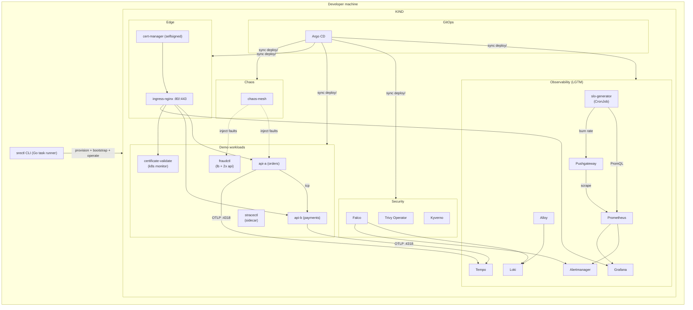
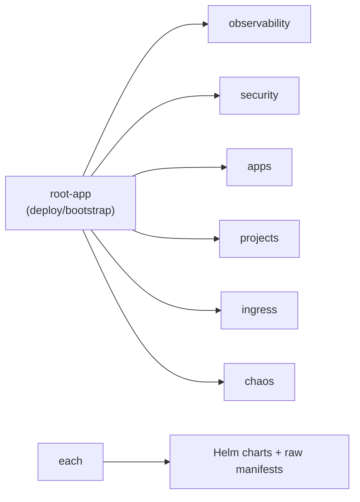
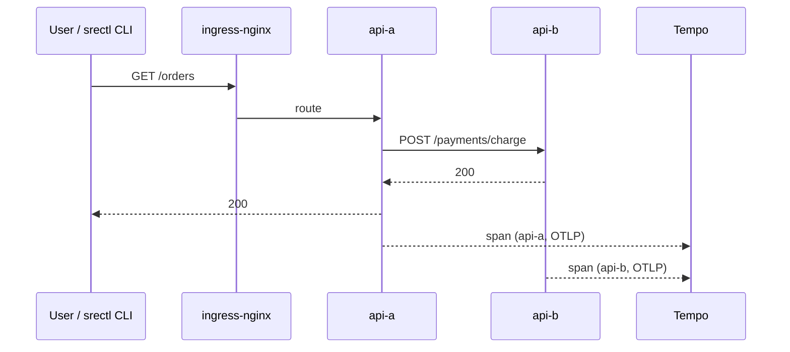
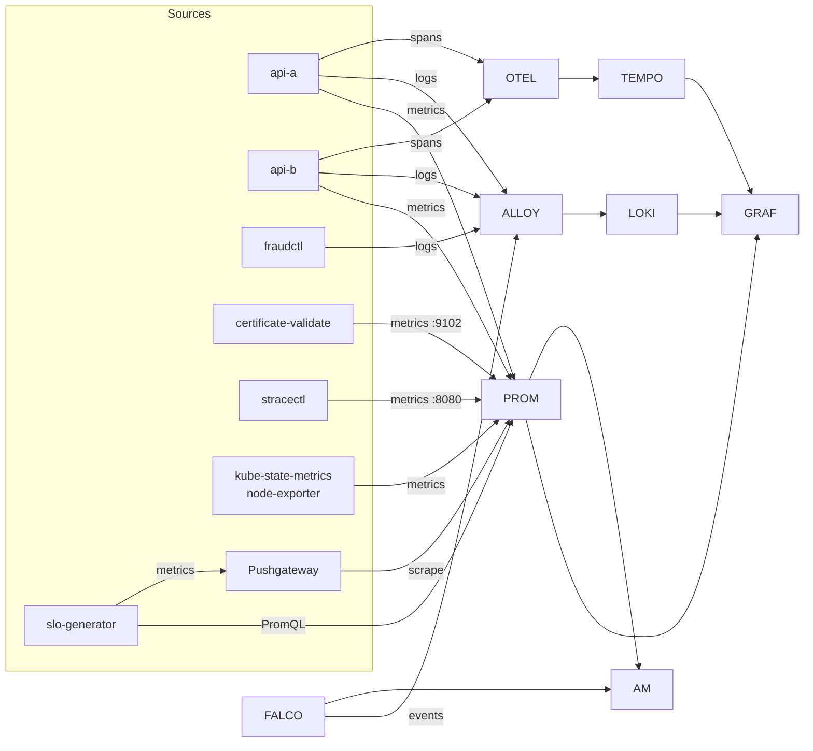
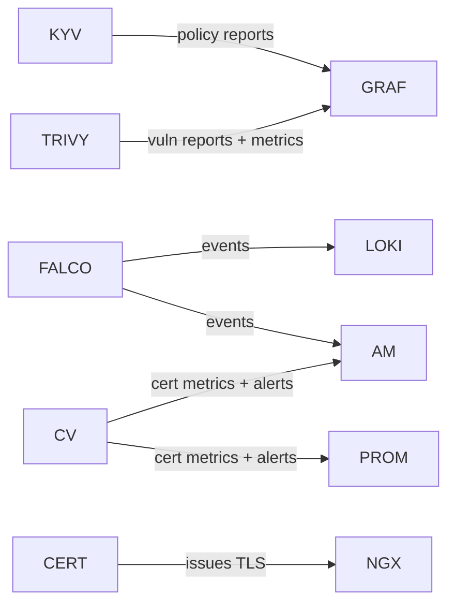

# Architecture

High-level design of **srectl**: how the pieces fit together on a local kind cluster.

## Big picture



## Control plane vs. data plane

- **Control plane (the `srectl` CLI):** a simple task runner that provisions kind,
  bootstraps Argo CD, and offers operational commands (`status`, `sync`, `open`,
  `demo`). It shells out to `kind`/`kubectl`/`helm`. It is the *only* imperative
  entry point.
- **Data plane (Argo CD):** everything inside the cluster is a GitOps resource under
  `deploy/`. Argo CD converges the cluster to the desired state.

```
srectl up ──► kind cluster ──► argo cd (bootstrap) ──► deploy/ (GitOps) ──► everything else
```

## Repository layout

```text
srectl/
├── cmd/srectl/                 # CLI entrypoint
├── internal/
│   ├── cli/                 # cobra commands
│   ├── config/              # srectl.yaml + env overrides
│   ├── kind/                # cluster lifecycle (wraps kind CLI)
│   ├── k8s/                 # kubectl/helm/port-forward wrappers
│   ├── argocd/              # bootstrap + app-of-apps
│   ├── demo/                # load gen + chaos + verify scripts
│   └── verify/              # smoke tests
├── apps/
│   ├── api-a/               # orders service (instrumented)
│   └── api-b/               # payments service (instrumented)
├── deploy/                  # GitOps source of truth (watched by Argo CD)
│   ├── bootstrap/           # argo cd install + root app
│   ├── ingress/             # ingress-nginx + cert-manager
│   ├── observability/       # LGTM stack
│   ├── security/            # trivy + falco + kyverno + netpol
│   ├── apps/                # api-a, api-b
│   └── projects/            # fraudctl, certificate-validate, stracectl
├── site/                    # Hugo bilingual site (GitHub Pages)
├── docs/
│   ├── en/                  # English docs
│   └── pt-br/               # Portuguese docs
├── config/srectl.yaml          # CLI defaults (cluster name, versions, toggles)
├── .github/workflows/ci.yml # CI (lint/test/build/e2e)
├── Makefile
└── go.mod
```

## App-of-apps pattern

Argo CD is installed imperatively once. A single **root `Application`** points at
`deploy/bootstrap/` and recursively creates child `Application`s, one per component
group:



## How the four services talk



Both APIs emit:

- **Metrics** → Prometheus (via `/metrics` + ServiceMonitor).
- **Logs** → Alloy → Loki (stdout, `slog` JSON).
- **Traces** → Tempo (OTLP :4318, exported directly by the apps).

## Observability data flow



## Security data flow



## Kind networking

ingress-nginx uses kind `extraPortMappings` so `localhost:80/443` on the host map into
the cluster:

```yaml
nodes:
  - role: control-plane
    extraPortMappings:
      - containerPort: 80
        hostPort: 80
      - containerPort: 443
        hostPort: 443
```

Services are exposed as `*.localhost` hosts (cert-manager selfsigned covers them),
making the whole stack reachable over TLS from the host with no cloud load balancer.

## Failure and recovery model

- **Self-healing:** Argo CD prunes drift; Deployments/ReplicaSets restart crashed pods.
- **Detection:** Prometheus rules + Falco events → Alertmanager.
- **Injection:** chaos-mesh faults let us practice detection and recovery deliberately.
- **Verification:** `srectl demo verify` asserts the cluster returns to healthy.

This is the environment the SLOs and runbooks in [`OBSERVABILITY.md`](OBSERVABILITY.md)
operate against.
