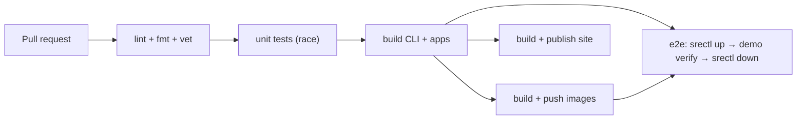

# CI/CD

The pipeline that keeps srectl trustworthy: lint, test, build, image, and a full
end-to-end run on a CI kind cluster.

## Pipeline (GitHub Actions)



### Jobs

| Job | Steps | Gates |
| --- | --- | --- |
| `lint` | `golangci-lint`, `go vet`, `gofmt -l` | zero warnings |
| `test` | `go test -race ./...` (CLI + apps) | all pass, coverage ≥ 80% |
| `build` | compile `srectl`, `api-a`, `api-b` | binaries produced |
| `images` | build/push api-a, api-b (and project mirrors) | push to registry |
| `e2e` | `srectl up && srectl demo verify && srectl down` on kind | all checks green |
| `site` | build Hugo site → deploy GitHub Pages | site live on merge to `main` |

## Image strategy

- Images built with pinned Go version, multi-stage Dockerfiles, non-root user.
- Tags: `git sha` short + semantic version; **no `latest`** (Kyverno enforces this).
- The three external projects (fraudctl, stracectl, certificate-validate) are built
  from their own repos and mirrored into the same registry, so Argo CD has stable
  references.

## GitOps & CI handoff

CI **builds and pushes images**; it never runs `kubectl apply` against production state.
Argo CD is the only deployer:

```
CI: build → push image → update deploy/*/values.yaml image tag (PR) → merge
Argo CD: detect change → sync → converge
```

Image tag updates are automated via a lightweight renovate/dependabot-style step (or a
`make bump` helper) so manifests stay pinned and reviewable.

## E2E smoke test (`srectl demo verify`)

Asserts, in order:

1. Cluster + Argo CD healthy.
2. All component Apps `Synced + Healthy`.
3. Prometheus scrape targets `UP`.
4. `api-a → api-b` request returns 200 with a valid trace id.
5. A forced error increments `http_errors_total` and fires the alert.
6. `certificate_days_left` metric present.
7. chaos injection raises latency and the stack recovers.

## Local equivalent

Everything CI runs is reproducible locally:

```bash
make lint
make test
make build
make site-dev    # local Hugo site (bilingual)
make e2e         # same as: srectl up && srectl demo verify && srectl down
```
