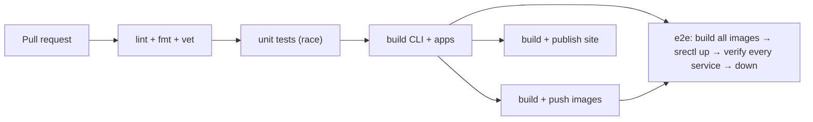

# CI/CD

The pipeline that keeps srectl trustworthy: lint, test, build, image, and a full
end-to-end run on a CI kind cluster.

## Pipeline (GitHub Actions)



### Jobs

| Job | Steps | Gates |
| --- | --- | --- |
| `lint` | `golangci-lint`, `go vet`, `gofmt -l` | zero warnings |
| `test` | `go test -race ./...` (CLI + apps) | all pass, coverage ≥ 80% |
| `build` | compile `srectl`, `api-a`, `api-b` | binaries produced |
| `images` | build/push api-a, api-b (and project mirrors) | push to registry |
| `e2e` | build every image → `srectl up` → verify cluster + all services + SLO + chaos → `srectl down` | all checks green |
| `site` | build Hugo site → deploy GitHub Pages | site live on merge to `main` |

## Image strategy

- Images built with pinned Go version, multi-stage Dockerfiles, non-root user.
- Tags: `git sha` short + semantic version; **no `latest`** (Kyverno enforces this).
- The three external projects (fraudctl, stracectl, certificate-validate) are built
  from their own repos and mirrored into the same registry, so Argo CD has stable
  references.

## GitOps & CI handoff

CI **builds and pushes images**; it never runs `kubectl apply` against production state.
Argo CD is the only deployer:

```
CI: build → push image → update deploy/*/values.yaml image tag (PR) → merge
Argo CD: detect change → sync → converge
```

Image tag updates are automated via a lightweight renovate/dependabot-style step (or a
`make bump` helper) so manifests stay pinned and reviewable.

## E2E pipeline (`.github/workflows/e2e.yml`)

Runs nightly and on `workflow_dispatch`. It tests the **exact commit** (Argo CD is
pointed at `github.sha` via `SRECTL_ARGOCD_REVISION`), not whatever `main` happens
to be. For the full implementation record, diagrams and the list of problems this
pipeline caught, see [`SLO_E2E.md`](SLO_E2E.md).

Steps:

1. Build the CLI, the demo APIs, `slo-generator`, `fraudctl` (+ LB) and
   `certificate-validate` from source, then load every image into kind.
2. Create the cluster, `srectl up` (Argo CD bootstraps the platform).
3. Wait for every Argo CD Application to be `Synced + Healthy`.
4. Run [`scripts/e2e-verify.sh`](../../scripts/e2e-verify.sh), which asserts:
   - every pod in every namespace is `Ready` (batch `slo-generator` pods excluded);
   - ingress endpoints: `hello`, `api-a` (`/health`, `/ready`, `/orders`),
     `fraudctl` (`/ready` + a real `POST /fraud-score`), `seraph`;
   - in-cluster services: Prometheus, Alertmanager, Grafana, Loki, Tempo, api-b,
     stracectl and certificate-validate `/metrics`;
   - metrics exist in Prometheus (`api_a_*`, `api_b_*`, ingress, certificates,
     stracectl);
   - `srectl slo compute` exports `error_budget_burn_rate` and
     `srectl slo status` lists the SLOs;
   - a chaos pod-kill on fraudctl recovers (skippable with `skip_chaos`).
5. On failure, dump nodes, Argo apps, pods, workloads, events and key logs.
6. Always run `srectl down`.

## Local equivalent

Everything CI runs is reproducible locally:

```bash
make lint
make test
make build
make site-dev    # local Hugo site (bilingual)
make e2e         # verify a running cluster end-to-end (scripts/e2e-verify.sh)
```

For the full pipeline locally: build/load the images, `srectl up`, then `make e2e`.
Set `E2E_SKIP_CHAOS=true` to skip the chaos drill.
