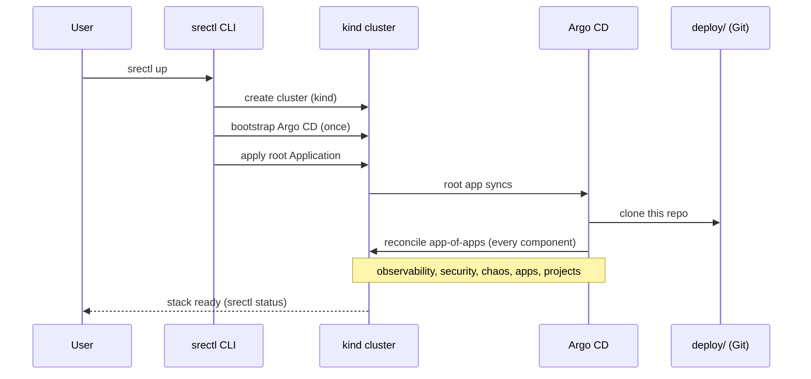

# GitOps

How Argo CD drives the cluster, and the layout of the `deploy/` tree.

## How the stack is born

Everything starts from one command (`srectl up`), but the stack is **not built by the
CLI** — the CLI prepares the ground and hands over to Argo CD:



Steps:

1. `srectl up` provisions the kind cluster (nodes, ingress port-mapping).
2. `srectl bootstrap` installs Argo CD — the only imperative step.
3. The root `Application` is applied; Argo CD clones this repo.
4. Argo CD reconciles the app-of-apps, deploying every component from `deploy/`.
5. `srectl` never applies workloads again — it only reads status or triggers syncs.

| Layer | Installed by | How |
| --- | --- | --- |
| kind cluster | CLI | `kind create cluster` |
| Argo CD | CLI | `srectl bootstrap` (imperative, once) |
| Everything else | Argo CD | reconciles `deploy/` (GitOps) |

The single entry point is `srectl`; the single source of truth is `deploy/`. Deliberate
split: one command to stand up, declarative/versioned management afterwards.

## Principle

The `deploy/` directory is the **single source of truth**. The `srectl` CLI never applies
workloads directly — it only provisions kind, bootstraps Argo CD once, and then lets
Argo CD converge everything.

```
deploy/ ──(watched by Argo CD)──► desired state ──► cluster
```

## Bootstrap

`srectl bootstrap` performs the one-time imperative install:

1. `kubectl create ns argocd`.
2. Install Argo CD (Helm or `kubectl apply -n argocd -f install.yaml`).
3. Apply the **root `Application`** (`deploy/bootstrap/argocd/root-app.yaml`).

The root app points at `deploy/bootstrap/apps/` (app-of-apps) and Argo CD takes over
from there.

## App-of-apps

```text
deploy/bootstrap/apps/
├── observability-app.yaml     # → deploy/observability
├── security-app.yaml          # → deploy/security
├── ingress-app.yaml           # → deploy/ingress
├── apps-app.yaml              # → deploy/apps
├── projects-app.yaml          # → deploy/projects
└── chaos-app.yaml             # → deploy/chaos
```

Each child `Application` has:

- `syncPolicy.automated` with `selfHeal: true` and `prune: true` (drift is corrected).
- `targetRevision: main` (or a pinned tag) of this repo.
- A `namespace` and `directory`/`chart` source.

## Directory conventions

```text
deploy/
├── bootstrap/            # argo cd install + root app + app-of-apps
├── ingress/              # ingress-nginx, cert-manager, ClusterIssuer
├── observability/        # kube-prometheus-stack, loki, alloy, tempo, otel
├── security/             # trivy-operator, falco, kyverno, netpols
├── apps/                 # api-a, api-b (namespace, deployment, service, sm)
├── projects/
│   ├── fraudctl/         # lb + 2x api, service, exporter
│   ├── certificate-validate/  # daemonset, servicemonitor, prometheusrule, ingress
│   └── stracectl/        # sidecar injection example + demo pod
└── chaos/                # chaos-mesh + experiment definitions
```

## Sync & status

| Command | Action |
| --- | --- |
| `srectl sync` | trigger Argo CD sync (all, or `-a apps`) |
| `srectl status` | aggregated `App` health + cluster/component matrix |
| `srectl apps restart` | `kubectl rollout restart` the demo workloads |

## Drift management

- Self-heal: manual `kubectl` edits are reverted by Argo CD.
- Prune: resources removed from Git are deleted from the cluster.
- Secrets are **not** managed by GitOps (see [`SECURITY.md`](SECURITY.md)); Argo CD's
  diff is scoped to avoid secret churn.
