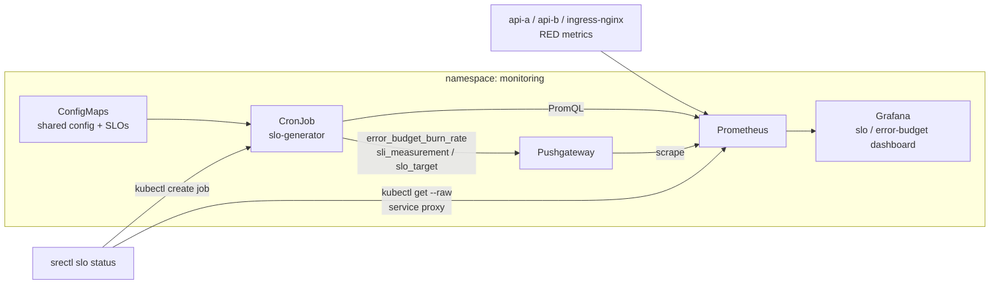

# SLO-as-code with slo-generator

srectl ships SLOs in two layers:

1. **Prometheus recording rules** (`deploy/observability/slo-rules.yaml`) — fast,
   dashboard-friendly SLI time series.
2. **`slo-generator`** (`deploy/slo/`) — declarative `ServiceLevelObjective`
   resources that compute the **error budget**, the **burn rate** and the
   **error-budget policy** for each objective, then export the results back to
   Prometheus.

The first layer answers *"how is the SLI doing right now?"*. The second answers
*"how much of the error budget did we spend, how fast, and must we page someone?"*.
Together they teach the full Google SRE loop without leaving the local kind
cluster.

> Upstream project: [`fabianoflorentino/slo-generator`](https://github.com/fabianoflorentino/slo-generator)
> (fork of [`google/slo-generator`](https://github.com/google/slo-generator)).
> It is a Python tool; srectl consumes it as a container image and keeps the
> Go CLI as a thin task runner.
>
> The full implementation record (architecture, control loop, e2e pipeline and
> fixes) is in [`SLO_E2E.md`](SLO_E2E.md).

## Concepts in one page

| Concept | Formula | In srectl |
| --- | --- | --- |
| SLI | `good_events / valid_events` | PromQL over api-a, api-b and ingress metrics |
| SLO | target for an SLI over a window | `goal` in the `ServiceLevelObjective` |
| Error budget (EB) | `1 - SLI` | computed by `slo-generator` |
| Burn rate | `EB spent / EB allowed` | `error_budget_burn_rate` metric |
| Error-budget policy | actions per burn-rate threshold | `error_budget_policies` in the shared config |

The burn rate is the alerting signal: a 1x burn rate spends the budget exactly at
the end of the window; 14.4x spends it in ~2 days. Alerting on multi-window burn
rates is more stable than alerting on a raw SLI threshold.

## Architecture



### Components

| Piece | Manifest | Purpose |
| --- | --- | --- |
| Shared config | `deploy/slo/configmap-shared.yaml` | Prometheus backend, Pushgateway exporter, error-budget policies |
| SLOs | `deploy/slo/configmap-slos.yaml` | One `ServiceLevelObjective` per file/key |
| CronJob | `deploy/slo/cronjob.yaml` | Runs `slo-generator compute --export` every minute |
| Pushgateway | `deploy/slo/pushgateway.yaml` | Receives the computed metrics |
| ServiceMonitor | `deploy/slo/pushgateway.yaml` | Makes Prometheus scrape the Pushgateway |
| Dashboard | `deploy/slo/dashboard.yaml` | Burn rate, budget, SLI vs target |
| Argo CD app | `deploy/bootstrap/apps/slo-app.yaml` | Applies the whole folder with GitOps |
| Image | `apps/slo-generator/Dockerfile` | Pinned `slo-generator` runtime published by CI |

## Implementation & integration plan

1. **Package the tool.** `apps/slo-generator/Dockerfile` builds a small image from
   the fork (`pip install /src[prometheus]`). CI publishes
   `ghcr.io/fabianoflorentino/srectl-slo-generator`.
2. **Declare the SLOs.** Add one `ServiceLevelObjective` per service/feature to
   `configmap-slos.yaml`:
   - `api-a` availability (`good_bad_ratio`);
   - `api-a` latency (`distribution_cut` on `le="0.02"`);
   - `fraudctl` availability and latency (via ingress-nginx).
3. **Declare the policy.** `configmap-shared.yaml` defines multi-window steps
   (1h / 6h / 3d) with burn-rate thresholds and page/ticket messages.
4. **Schedule the computation.** The CronJob mounts both ConfigMaps and runs
   `slo-generator compute -f /etc/slo/slos -c /etc/slo/config.yaml --export`.
5. **Export the results.** The `prometheus` exporter pushes to the in-cluster
   Pushgateway; a ServiceMonitor makes Prometheus scrape it.
6. **Operate it from the CLI.** `srectl slo compute` triggers a one-off Job;
   `srectl slo status` reads the exported metrics through the Kubernetes API
   service proxy (no port-forward needed).
7. **Teach it.** The SRE section of the site and the runbooks turn the numbers
   into exercises (budget burn, release freeze, multi-window alerting).

### Why not only recording rules?

Recording rules pre-compute the SLI, but they do not model **error budgets** or
**policies**. `slo-generator` keeps the objective, the policy and the report in
one versioned YAML object, which is also how real SRE teams manage SLOs. The
recording rules remain useful for fast dashboards and for feed-forward
PromQL from existing panels.

## Shipped SLOs

| Name | Backend method | SLI | Goal |
| --- | --- | --- | --- |
| `api-a-availability` | `good_bad_ratio` | non-5xx `/orders` requests / all `/orders` | 99.5% |
| `api-a-latency` | `distribution_cut` | requests ≤ 20ms / all `/orders` | 99.0% |
| `fraudctl-availability` | `good_bad_ratio` | non-5xx ingress requests / all | 99.5% |

The policy (`default`) has three windows:

| Step | Window | Burn-rate threshold | Action |
| --- | --- | --- | --- |
| 1h | 3600s | 14.4x | page |
| 6h | 21600s | 6x | page |
| 3d | 259200s | 1x | ticket / freeze |

## CLI

```bash
srectl slo compute     # run a one-off slo-generator Job and wait for completion
srectl slo status      # table: service, SLO, burn rate, threshold, state
```

Open Grafana and select **srectl · SLO / Error Budget** to see the same data
graphically:

```bash
srectl open grafana
```

## Lab: burn the error budget

Prerequisites: `srectl up`, `srectl demo verify`, and a green SLO dashboard.

1. **Baseline.** Run `srectl slo compute` once and `srectl slo status`; every
   row should be below its threshold.
2. **Load.** Generate healthy traffic:
   ```bash
   srectl demo load --duration 120s --rps 30
   ```
3. **Break it.** Inject CPU stress on api-a so latency rises:
   ```bash
   srectl demo chaos latency --duration 120s
   ```
4. **Observe.** While the drill runs:
   ```bash
   srectl slo status
   ```
   The `api-a` latency burn rate rises above the 1h threshold; the Grafana panel
   turns red.
5. **Decide.** Read the policy messages: page (1h/6h) vs. release freeze (3d).
   Write down what you would do as the on-call engineer.
6. **Recover.** Let the chaos experiment expire and confirm the burn rate returns
   below the threshold.

### Discussion prompts

- Why is a 99.5% goal over 30 days different from "no 5xx in the last hour"?
- Which SLI is more honest for `fraudctl`: a response from the ingress or from
  the application? What does each hide?
- When is alerting on `error_budget_burn_rate` better than alerting on the raw
  SLI? When is it worse?
- What is the cost of a false page compared with the cost of a missed SLO?

## Operations

| Symptom | Check |
| --- | --- |
| `slo status` says "no metrics yet" | `kubectl get jobs -n monitoring -l job-name=slo-generator`; run `srectl slo compute` |
| CronJob fails | `kubectl logs -n monitoring -l job-name=slo-generator --tail=100` |
| Prometheus has no `error_budget_burn_rate` | Pushgateway is up; its ServiceMonitor target is `UP`; the CronJob has run at least once |
| Burn rate is always zero | the PromQL selectors do not match any series — check the route/ingress labels in `configmap-slos.yaml` |
| Image pull error | publish the image (see `apps/slo-generator/Dockerfile`) and pin the tag in `cronjob.yaml` |

Useful commands:

```bash
kubectl -n monitoring get cronjob,job,pod -l app=slo-generator
kubectl -n monitoring create job --from=cronjob/slo-generator slo-manual
kubectl -n monitoring logs job/slo-manual
kubectl -n monitoring get --raw \
  '/api/v1/namespaces/monitoring/services/http:kube-prometheus-stack-prometheus:9090/proxy/api/v1/query?query=error_budget_burn_rate'
```

## References

- [Google SRE Book — Service Level Objectives](https://sre.google/sre-book/service-level-objectives/)
- [Google SRE Workbook — Alerting on SLOs](https://sre.google/workbook/alerting-on-slos/)
- [`fabianoflorentino/slo-generator`](https://github.com/fabianoflorentino/slo-generator)
- [`docs/en/OBSERVABILITY.md`](OBSERVABILITY.md) — the LGTM stack behind the metrics
