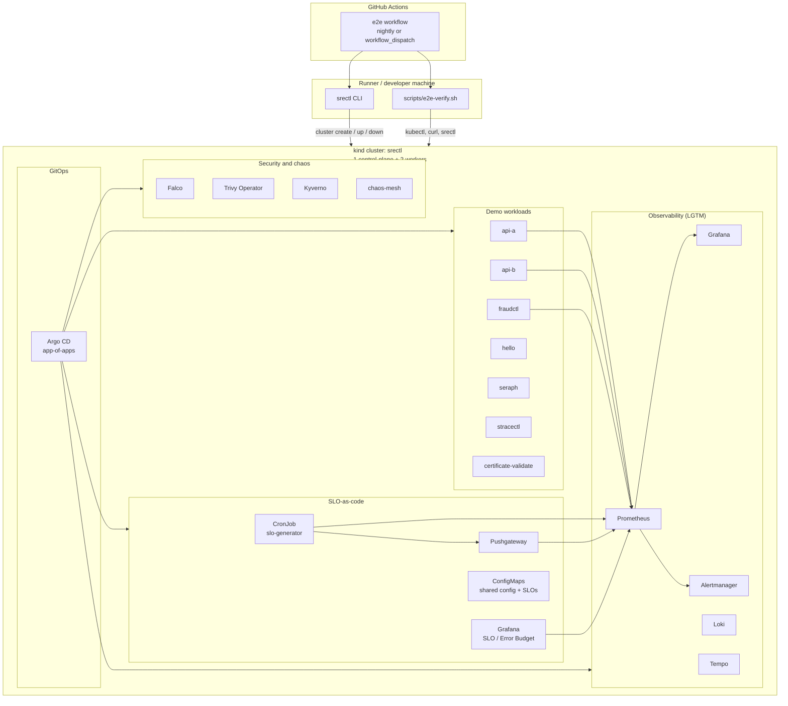
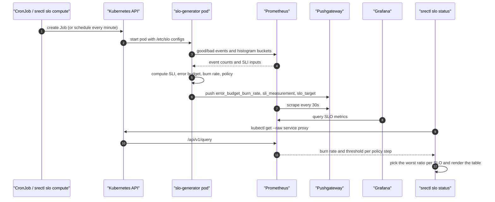
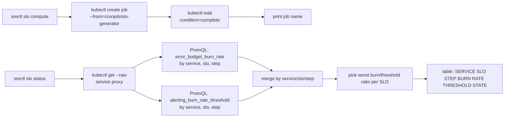
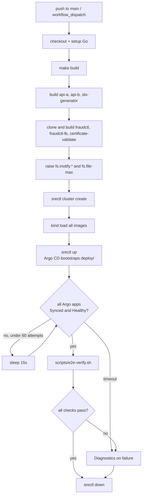
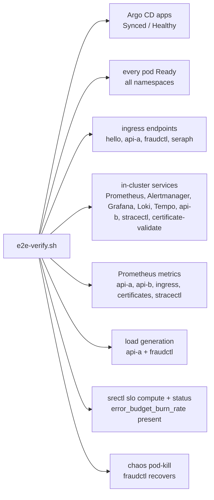
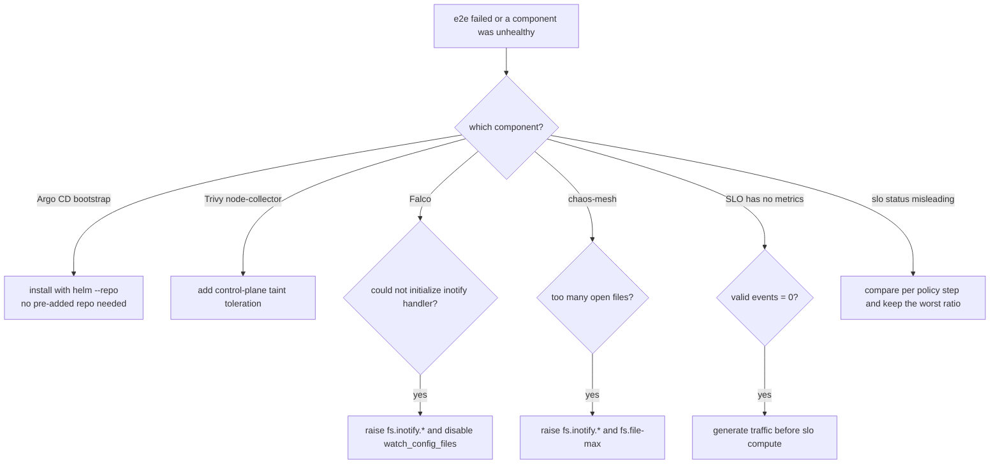

# SLO-as-code + end-to-end pipeline — implementation notes

This document is the implementation record for two features shipped together:

1. **SLO-as-code** with [`slo-generator`](https://github.com/fabianoflorentino/slo-generator):
   declarative `ServiceLevelObjective` resources, error budgets, burn rates and a
   multi-window error-budget policy.
2. **A full end-to-end GitHub Actions pipeline** that builds every image, brings the
   whole platform up on kind, and verifies the cluster, every service, the metrics,
   the SLOs and a chaos drill.

It complements:

- [`SLO.md`](SLO.md) — SLO concepts, design and the hands-on lab.
- [`CI_CD.md`](CI_CD.md) — pipeline overview and image strategy.
- [`OBSERVABILITY.md`](OBSERVABILITY.md) — the LGTM stack behind the metrics.

## 1. What was delivered

| Area | Delivered |
| --- | --- |
| SLO model | 3 `ServiceLevelObjective` resources (`api-a` availability/latency, `fraudctl` availability) |
| Error-budget policy | 1h @ 14.4x (page), 6h @ 6x (page), 3d @ 1x (release freeze) |
| Runtime | `slo-generator` CronJob every minute + on-demand Job |
| Export | Pushgateway + ServiceMonitor + Prometheus metrics |
| Dashboards | Grafana **srectl · SLO / Error Budget** |
| CLI | `srectl slo compute` and `srectl slo status` |
| Image | `apps/slo-generator/Dockerfile` → `ghcr.io/.../srectl-slo-generator:v0.1.0` |
| GitOps | `deploy/slo/` applied by the `slo` Argo CD Application |
| E2E pipeline | `.github/workflows/e2e.yml` + `scripts/e2e-verify.sh` |
| Verification | nightly/manual e2e green on GitHub Actions; full local run green |
| Docs/site | EN + PT-BR guides, runbook entry, Hugo pages |

## 2. End-to-end architecture



## 3. SLO control loop



### 3.1 SLO resources

| Name | Method | SLI | Goal |
| --- | --- | --- | --- |
| `api-a-availability` | `good_bad_ratio` | non-5xx `GET /orders` requests / all `GET /orders` | 99.5% |
| `api-a-latency` | `distribution_cut` | `GET /orders` requests ≤ 20ms / all | 99.0% |
| `fraudctl-availability` | `good_bad_ratio` | non-5xx ingress requests / all for `ingress=fraudctl` | 99.5% |

> `api-a-latency` uses the `le="0.02"` histogram bucket. The demo apps add `0.02`
> to the Prometheus default buckets so the SLO has an exact bucket to count.

### 3.2 Error-budget policy

| Step | Window | Burn-rate threshold | Consequence |
| --- | --- | --- | --- |
| 1 hour | 3600s | 14.4x | page the on-call engineer |
| 6 hours | 21600s | 6x | page the on-call engineer |
| 3 days | 259200s | 1x | freeze releases unless reliability/security related |

### 3.3 Exported metrics

| Metric | Purpose |
| --- | --- |
| `error_budget_burn_rate` | burn rate per service/SLO/policy step |
| `alerting_burn_rate_threshold` | threshold for each policy step |
| `sli_measurement` | measured SLI over time |
| `slo_target` | target line for dashboards |
| `events_count` | good/bad event counts |

Labels: `service_name`, `feature_name`, `slo_name`,
`error_budget_policy_step_name`, plus flattened metadata labels.

## 4. `srectl slo` command flow



| Command | Behavior |
| --- | --- |
| `srectl slo compute` | creates a one-off Job from the CronJob, waits up to 120s, prints the Job name |
| `srectl slo status` | reads the exported metrics through the Kubernetes service proxy (no port-forward), picks the worst policy step per SLO, prints a table |

The table compares **burn rate vs threshold per policy step** and keeps the worst
step, so a slow 3-day burn (threshold 1x) is never hidden by the 1-hour threshold
(14.4x).

## 5. End-to-end pipeline



The workflow points Argo CD at the **exact commit under test**:

```yaml
env:
  SRECTL_ARGOCD_REPO: ${{ github.server_url }}/${{ github.repository }}
  SRECTL_ARGOCD_REVISION: ${{ github.sha }}
```

### 5.1 Images built by the pipeline

| Image | Source |
| --- | --- |
| `srectl/api-a:dev` | `apps/api-a/Dockerfile` |
| `srectl/api-b:dev` | `apps/api-b/Dockerfile` |
| `ghcr.io/fabianoflorentino/srectl-slo-generator:v0.1.0` | `apps/slo-generator/Dockerfile` (tag read from `deploy/slo/cronjob.yaml`) |
| `srectl/fraudctl:dev`, `srectl/fraudctl-lb:dev` | `github.com/fabianoflorentino/fraudctl` |
| `srectl/certificate-validate:dev` | `github.com/fabianoflorentino/certificate-validate` |

`stracectl` and `seraph` use their published images and are pulled normally.

### 5.2 What `scripts/e2e-verify.sh` checks



1. `srectl demo verify` — cluster, Argo CD and every Application.
2. Every pod in every namespace is `Ready` (batch `slo-generator` pods excluded).
3. Ingress endpoints: `hello`, `api-a` (`/health`, `/ready`, `/orders`), `fraudctl`
   (`/ready` and a real `POST /fraud-score`) and `seraph`.
4. In-cluster services via the service proxy.
5. Metrics exist in Prometheus.
6. Traffic is generated, `srectl slo compute` runs, and `srectl slo status` lists
   the SLOs.
7. A chaos `pod-kill` on `fraudctl` recovers.

On failure the workflow dumps nodes, Applications, pods, workloads, events,
`kubectl top`, host memory, inotify limits and Falco/chaos-mesh logs, then always
runs `srectl down`.

## 6. Problems found and fixed during the implementation



| Symptom | Root cause | Fix |
| --- | --- | --- |
| `Error: repo argo not found` | `helm upgrade` assumed the `argo` repo was already added | `helm upgrade --install argo-cd argo-cd --repo https://argoproj.github.io/argo-helm` |
| Trivy `node-collector` stuck `Pending` | it targets the control-plane by hostname but did not tolerate its taint | `nodeCollector.tolerations` for `node-role.kubernetes.io/control-plane:NoSchedule` |
| Falco `could not initialize inotify handler` | the full stack exhausts the runner's inotify instances | `sysctl fs.inotify.*` in the workflow + `falco.watch_config_files: false` |
| chaos-mesh `too many open files` | controller-runtime informers exhaust inotify/file limits | raise `fs.inotify.*` and `fs.file-max` before creating the cluster |
| `slo-generator` crashes on start (`pkg_resources`) | setuptools 81+ removed `pkg_resources`, used by slo-generator | pin `setuptools<81` in the image |
| SLOs report `Not enough valid events (0.0)` | no traffic in the SLO window | generate load before `slo compute` |
| `slo status` could hide a slow burn | compared the max burn rate with the max threshold | merge by policy step and keep the worst burn/threshold ratio |

## 7. Verification evidence

| Check | Result |
| --- | --- |
| GitHub Actions e2e (run `44619937023`) | **success** in 11m17s |
| GitHub Actions `ci` on the same push | **success** |
| Local full e2e (`scripts/e2e-verify.sh`) | all checks green, including SLO and chaos |
| `go test -race ./...` | pass |
| `make coverage` | 82.0% overall; `internal/slo` 96.4%; `internal/cli` 84.3% |
| `golangci-lint run ./...` | 0 issues |
| Hugo site build | EN/PT-BR pages built |

The e2e run proves the whole chain: images built from source → cluster created →
Argo CD applied the exact commit → all services reachable → metrics present →
`error_budget_burn_rate` exported → chaos drill recovered.

## 8. File map

| Path | Responsibility |
| --- | --- |
| `deploy/slo/configmap-shared.yaml` | Prometheus backend, Pushgateway exporter, error-budget policy |
| `deploy/slo/configmap-slos.yaml` | the three `ServiceLevelObjective` resources |
| `deploy/slo/cronjob.yaml` | scheduled `slo-generator compute --export` |
| `deploy/slo/pushgateway.yaml` | Pushgateway Deployment/Service/ServiceMonitor |
| `deploy/slo/dashboard.yaml` | Grafana **srectl · SLO / Error Budget** |
| `deploy/bootstrap/apps/slo-app.yaml` | Argo CD Application for `deploy/slo` |
| `apps/slo-generator/Dockerfile` | pinned slo-generator image (`setuptools<81`) |
| `internal/slo/slo.go` | Job trigger + Prometheus service-proxy queries + table |
| `internal/cli/slo.go` | `srectl slo compute` and `srectl slo status` |
| `internal/config/config.go` | `slo.*` configuration and defaults |
| `config/srectl.yaml` | namespace, CronJob, Prometheus service/port |
| `.github/workflows/e2e.yml` | full e2e pipeline |
| `scripts/e2e-verify.sh` | service/SLO/chaos assertions used locally and in CI |
| `Makefile` | `docker-build-slo` (pinned tag) and `e2e` targets |
| `.github/workflows/images.yml` | publishes `srectl-slo-generator` |
| `deploy/bootstrap/apps/falco-app.yaml` | `watch_config_files: false` |
| `deploy/bootstrap/apps/trivy-operator-app.yaml` | node-collector toleration |
| `internal/appobs/metrics.go` | adds the `0.02` histogram bucket used by the latency SLO |

## 9. Operations

```bash
# Bring the platform up (local)
srectl up
srectl demo verify

# Image used by the CronJob (exact tag from the manifest)
make docker-build-slo
kind load docker-image "$(awk '/srectl-slo-generator/ {print $2; exit}' deploy/slo/cronjob.yaml)" --name srectl

# SLOs
srectl slo compute
srectl slo status
srectl open grafana   # dashboard: srectl · SLO / Error Budget

# Full e2e against a running cluster
make e2e

# Full e2e on GitHub Actions
gh workflow run e2e.yml
gh workflow run e2e.yml -f skip_chaos=true
```

## 10. Troubleshooting

| Symptom | Check |
| --- | --- |
| `slo status` shows "no exported metrics" | run `srectl slo compute`; confirm the Job completed and Prometheus scraped the Pushgateway |
| SLOs log `Not enough valid events` | generate traffic (`srectl demo load`) before computing |
| CronJob cannot pull the image | build/load the tag pinned in `deploy/slo/cronjob.yaml`, or publish it with the `images` workflow |
| Falco crash-loops on a CI runner | check `fs.inotify.max_user_instances`; the workflow raises it |
| chaos controller `too many open files` | same inotify/file-max limits |
| Trivy node-collector `Pending` | confirm the control-plane toleration is present |
| e2e stuck waiting for apps | run `srectl status`; the diagnostics step lists the failing Applications |

## 11. Known limitations and follow-ups

- The e2e is **nightly/manual** because it is heavy (full LGTM + security + chaos
  stack). It is not on every pull request.
- GitHub-hosted runners need explicit inotify/file-limit tuning; the workflow does
  it, but a different runner image may need different values.
- The `slo-generator` image is pinned to `v0.1.0`; the e2e builds and loads that
  exact tag. For a release, tag the repository so `images.yml` publishes it.
- `srectl slo status` reports the worst policy step per SLO; the Grafana dashboard
  shows every step. Use the dashboard when you need the full multi-window picture.
