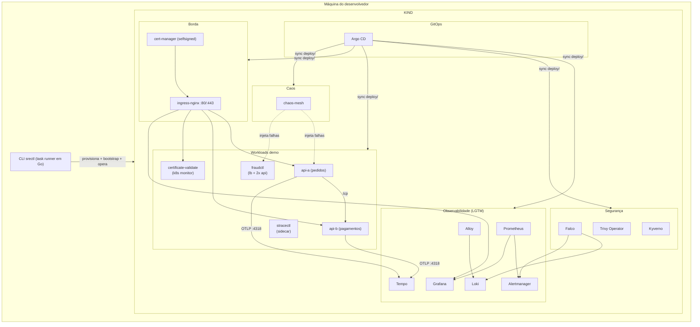
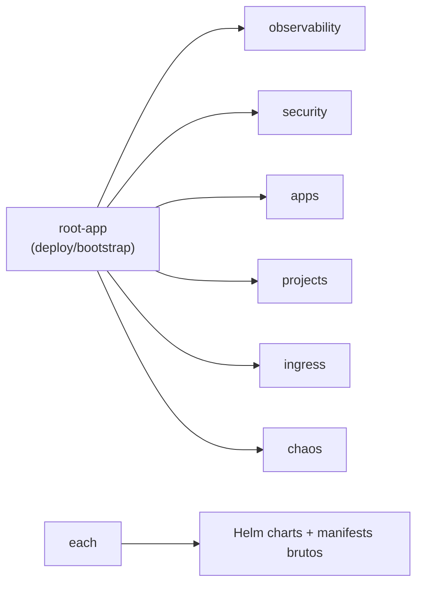
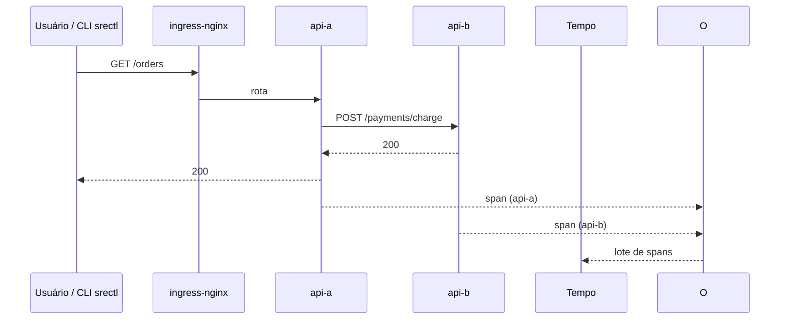
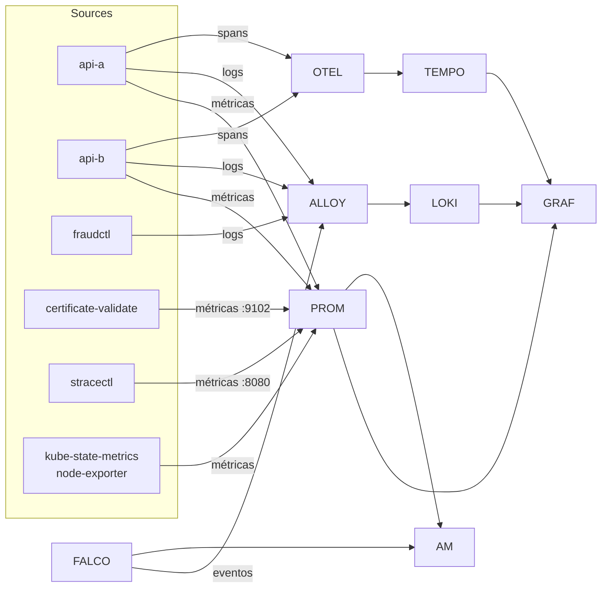
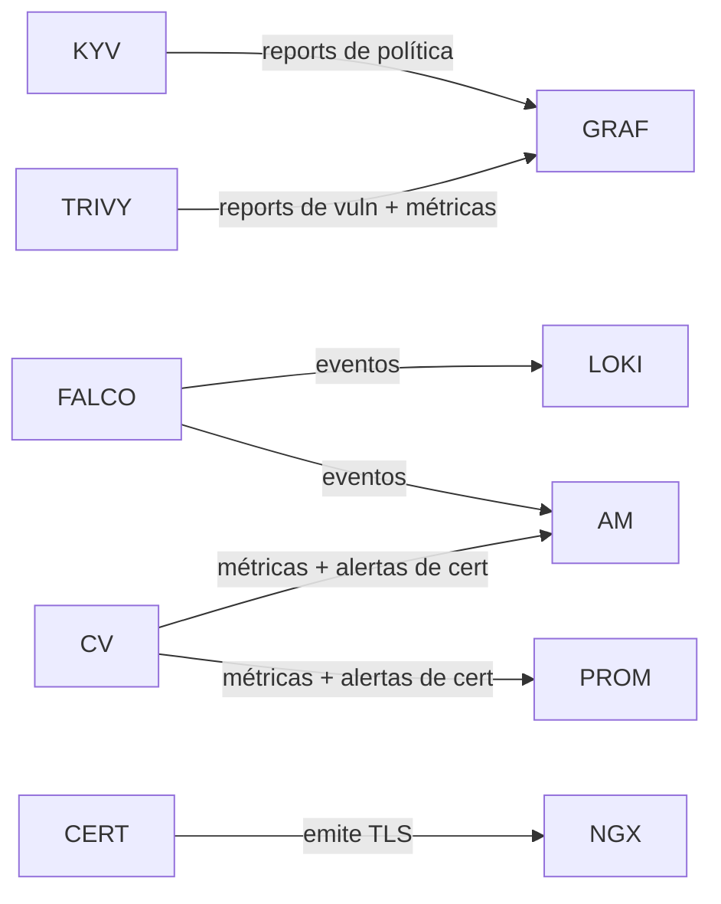

# Arquitetura

Design de alto nível do **srectl**: como as peças se encaixam num cluster kind local.

## Visão geral



## Plano de controle vs. plano de dados

- **Plano de controle (CLI `srectl`):** um task runner simples que provisiona o kind,
  faz o bootstrap do Argo CD e oferece comandos operacionais (`status`, `sync`, `open`,
  `demo`). Ele chama `kind`/`kubectl`/`helm`. É o *único* ponto de entrada imperativo.
- **Plano de dados (Argo CD):** tudo dentro do cluster é um recurso GitOps sob `deploy/`.
  O Argo CD converge o cluster para o estado desejado.

```
srectl up ──► cluster kind ──► argo cd (bootstrap) ──► deploy/ (GitOps) ──► todo o resto
```

## Layout do repositório

```text
srectl/
├── cmd/srectl/                 # entrypoint da CLI
├── internal/
│   ├── cli/                 # comandos cobra
│   ├── config/              # srectl.yaml + overrides por env
│   ├── kind/                # ciclo de vida do cluster (envolve o kind CLI)
│   ├── k8s/                 # wrappers de kubectl/helm/port-forward
│   ├── argocd/              # bootstrap + app-of-apps
│   ├── demo/                # scripts de carga + caos + verificação
│   └── verify/              # smoke tests
├── apps/
│   ├── api-a/               # serviço de pedidos (instrumentado)
│   └── api-b/               # serviço de pagamentos (instrumentado)
├── deploy/                  # fonte de verdade GitOps (observada pelo Argo CD)
│   ├── bootstrap/           # instalação do argo cd + root app
│   ├── ingress/             # ingress-nginx + cert-manager
│   ├── observability/       # stack LGTM
│   ├── security/            # trivy + falco + kyverno + netpol
│   ├── apps/                # api-a, api-b
│   └── projects/            # fraudctl, certificate-validate, stracectl
├── site/                    # site Hugo bilíngue (GitHub Pages)
├── docs/
│   ├── en/                  # docs em inglês
│   └── pt-br/               # docs em português
├── config/srectl.yaml          # defaults da CLI (nome do cluster, versões, toggles)
├── .github/workflows/ci.yml # CI (lint/test/build/e2e)
├── Makefile
└── go.mod
```

## Padrão app-of-apps

O Argo CD é instalado imperativamente uma única vez. Um único **root `Application`**
aponta para `deploy/bootstrap/` e cria recursivamente `Application`s filhos, um por
grupo de componentes:



## Como os quatro serviços conversam



As duas APIs emitem:

- **Métricas** → Prometheus (via `/metrics` + ServiceMonitor).
- **Logs** → Alloy → Loki (stdout, `slog` JSON).
- **Traces** → Tempo (OTLP :4318, exported directly by the apps).

## Fluxo de dados de observabilidade



## Fluxo de dados de segurança



## Rede no kind

O ingress-nginx usa `extraPortMappings` do kind para que `localhost:80/443` no host
mapeiem para dentro do cluster:

```yaml
nodes:
  - role: control-plane
    extraPortMappings:
      - containerPort: 80
        hostPort: 80
      - containerPort: 443
        hostPort: 443
```

Os serviços são expostos como hosts `*.localhost` (o cert-manager selfsigned os cobre),
tornando toda a stack acessível via TLS do host, sem load balancer de cloud.

## Modelo de falha e recuperação

- **Self-healing:** o Argo CD faz prune de drift; Deployments/ReplicaSets reiniciam pods
  que caíram.
- **Detecção:** regras do Prometheus + eventos do Falco → Alertmanager.
- **Injeção:** as falhas do chaos-mesh nos deixam praticar detecção e recuperação de
  forma deliberada.
- **Verificação:** `srectl demo verify` valida que o cluster voltou ao saudável.

É neste ambiente que operam os SLOs e runbooks do [`OBSERVABILITY.md`](OBSERVABILITY.md).
