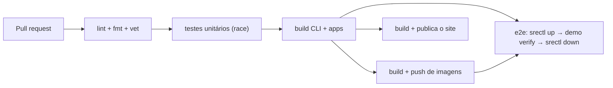

# CI/CD

O pipeline que mantém o srectl confiável: lint, test, build, imagem e um run
end-to-end completo num cluster kind de CI.

## Pipeline (GitHub Actions)



### Jobs

| Job | Passos | Gates |
| --- | --- | --- |
| `lint` | `golangci-lint`, `go vet`, `gofmt -l` | zero avisos |
| `test` | `go test -race ./...` (CLI + apps) | todos passam, coverage ≥ 80% |
| `build` | compila `srectl`, `api-a`, `api-b` | binários gerados |
| `images` | build/push api-a, api-b (e mirrors dos projetos) | push no registry |
| `e2e` | `srectl up && srectl demo verify && srectl down` no kind | todos os checks verdes |
| `site` | build do site Hugo → deploy GitHub Pages | site no ar no merge para `main` |

## Estratégia de imagens

- Imagens com versão de Go pinada, Dockerfiles multi-stage, usuário não-root.
- Tags: `git sha` curto + versão semântica; **sem `latest`** (o Kyverno impõe isso).
- Os três projetos externos (fraudctl, stracectl, certificate-validate) são buildados a
  partir dos próprios repos e espelhados no mesmo registry, para que o Argo CD tenha
  referências estáveis.

## Handoff CI & GitOps

A CI **builda e faz push de imagens**; nunca roda `kubectl apply` contra estado de
produção. O Argo CD é o único deployer:

```
CI: build → push da imagem → atualiza a tag em deploy/*/values.yaml (PR) → merge
Argo CD: detecta a mudança → sync → converge
```

As atualizações de tag são automatizadas via um passo leve no estilo renovate/dependabot
(ou um helper `make bump`) para que os manifests fiquem pinados e revisáveis.

## Smoke test E2E (`srectl demo verify`)

Valida, em ordem:

1. Cluster + Argo CD saudáveis.
2. Todos os Apps de componentes `Synced + Healthy`.
3. Alvos de scrape do Prometheus `UP`.
4. Requisição `api-a → api-b` retorna 200 com um trace id válido.
5. Um erro forçado incrementa `http_errors_total` e dispara o alerta.
6. Métrica `certificate_days_left` presente.
7. Injeção de caos eleva a latência e a stack se recupera.

## Equivalente local

Tudo que a CI roda é reproduzível localmente:

```bash
make lint
make test
make build
make site-dev    # site Hugo local (bilíngue)
make e2e         # igual a: srectl up && srectl demo verify && srectl down
```
