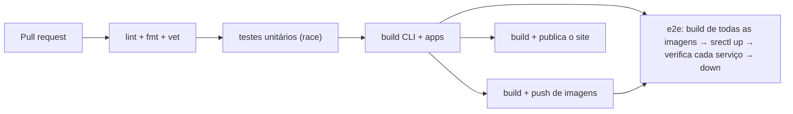

# CI/CD

O pipeline que mantém o srectl confiável: lint, test, build, imagem e um run
end-to-end completo num cluster kind de CI.

## Pipeline (GitHub Actions)



### Jobs

| Job | Passos | Gates |
| --- | --- | --- |
| `lint` | `golangci-lint`, `go vet`, `gofmt -l` | zero avisos |
| `test` | `go test -race ./...` (CLI + apps) | todos passam, coverage ≥ 80% |
| `build` | compila `srectl`, `api-a`, `api-b` | binários gerados |
| `images` | build/push api-a, api-b (e mirrors dos projetos) | push no registry |
| `e2e` | build de todas as imagens → `srectl up` → verifica cluster + serviços + SLO + caos → `srectl down` | todos os checks verdes |
| `site` | build do site Hugo → deploy GitHub Pages | site no ar no merge para `main` |

## Estratégia de imagens

- Imagens com versão de Go pinada, Dockerfiles multi-stage, usuário não-root.
- Tags: `git sha` curto + versão semântica; **sem `latest`** (o Kyverno impõe isso).
- Os três projetos externos (fraudctl, stracectl, certificate-validate) são buildados a
  partir dos próprios repos e espelhados no mesmo registry, para que o Argo CD tenha
  referências estáveis.

## Handoff CI & GitOps

A CI **builda e faz push de imagens**; nunca roda `kubectl apply` contra estado de
produção. O Argo CD é o único deployer:

```
CI: build → push da imagem → atualiza a tag em deploy/*/values.yaml (PR) → merge
Argo CD: detecta a mudança → sync → converge
```

As atualizações de tag são automatizadas via um passo leve no estilo renovate/dependabot
(ou um helper `make bump`) para que os manifests fiquem pinados e revisáveis.

## Pipeline E2E (`.github/workflows/e2e.yml`)

Roda nightly e via `workflow_dispatch`. Testa o **commit exato** (o Argo CD aponta
para `github.sha` via `SRECTL_ARGOCD_REVISION`), não o que estiver em `main`. Para
o registro completo da implementação, diagramas e a lista de problemas que o
pipeline encontrou, veja [`SLO_E2E.md`](SLO_E2E.md).

Passos:

1. Builda a CLI, as APIs demo, o `slo-generator`, o `fraudctl` (+ LB) e o
   `certificate-validate` a partir do código, e carrega todas as imagens no kind.
2. Cria o cluster e roda `srectl up` (o Argo CD sobe a plataforma).
3. Espera todos os Applications do Argo CD ficarem `Synced + Healthy`.
4. Roda [`scripts/e2e-verify.sh`](../../scripts/e2e-verify.sh), que valida:
   - todos os pods de todos os namespaces estão `Ready` (pods de batch do
     `slo-generator` excluídos);
   - endpoints de ingress: `hello`, `api-a` (`/health`, `/ready`, `/orders`),
     `fraudctl` (`/ready` + um `POST /fraud-score` real) e `seraph`;
   - serviços in-cluster: Prometheus, Alertmanager, Grafana, Loki, Tempo, api-b,
     stracectl e `/metrics` do certificate-validate;
   - métricas presentes no Prometheus (`api_a_*`, `api_b_*`, ingress,
     certificados, stracectl);
   - `srectl slo compute` exporta `error_budget_burn_rate` e `srectl slo status`
     lista os SLOs;
   - um pod-kill de caos no fraudctl se recupera (pode ser pulado com `skip_chaos`).
5. Em falha, despeja nodes, apps do Argo, pods, workloads, eventos e logs chave.
6. Sempre roda `srectl down`.

## Equivalente local

Tudo que a CI roda é reproduzível localmente:

```bash
make lint
make test
make build
make site-dev    # site Hugo local (bilíngue)
make e2e         # verifica um cluster em execução (scripts/e2e-verify.sh)
```

Para o pipeline completo localmente: build/carregue as imagens, `srectl up` e
depois `make e2e`. Use `E2E_SKIP_CHAOS=true` para pular o drill de caos.
