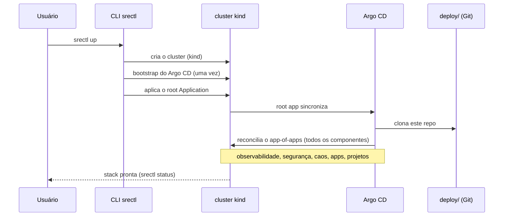

# GitOps

Como o Argo CD dirige o cluster e o layout da árvore `deploy/`.

## Como a stack nasce

Tudo parte de um único comando (`srectl up`), mas a stack **não** é construída pela CLI
— a CLI prepara o terreno e passa o bastão ao Argo CD:



Passos:

1. `srectl up` provisiona o cluster kind (nós, port-mapping do ingress).
2. `srectl bootstrap` instala o Argo CD — o único passo imperativo.
3. O root `Application` é aplicado; o Argo CD clona este repo.
4. O Argo CD reconcilia o app-of-apps, deployando cada componente de `deploy/`.
5. O `srectl` nunca aplica workloads de novo — só lê status ou dispara syncs.

| Camada | Instalado por | Como |
| --- | --- | --- |
| cluster kind | CLI | `kind create cluster` |
| Argo CD | CLI | `srectl bootstrap` (imperativo, uma vez) |
| Todo o resto | Argo CD | reconcilia `deploy/` (GitOps) |

O ponto de entrada único é o `srectl`; a fonte de verdade única é o `deploy/`. Divisão
deliberada: um comando para subir, gestão declarativa/versionada depois.

## Princípio

O diretório `deploy/` é a **fonte de verdade única**. A CLI `srectl` nunca aplica workloads
diretamente — ela só provisiona o kind, faz o bootstrap do Argo CD uma vez e deixa o
Argo CD convergir tudo.

```
deploy/ ──(observado pelo Argo CD)──► estado desejado ──► cluster
```

## Bootstrap

O `srectl bootstrap` faz a instalação imperativa única:

1. `kubectl create ns argocd`.
2. Instala o Argo CD (Helm ou `kubectl apply -n argocd -f install.yaml`).
3. Aplica o **root `Application`** (`deploy/bootstrap/argocd/root-app.yaml`).

O root app aponta para `deploy/bootstrap/apps/` (app-of-apps) e o Argo CD assume daí.

## App-of-apps

```text
deploy/bootstrap/apps/
├── observability-app.yaml     # → deploy/observability
├── security-app.yaml          # → deploy/security
├── ingress-app.yaml           # → deploy/ingress
├── apps-app.yaml              # → deploy/apps
├── projects-app.yaml          # → deploy/projects
└── chaos-app.yaml             # → deploy/chaos
```

Cada `Application` filho tem:

- `syncPolicy.automated` com `selfHeal: true` e `prune: true` (o drift é corrigido).
- `targetRevision: main` (ou uma tag pinada) deste repo.
- Uma `namespace` e fonte `directory`/`chart`.

## Convenções de diretórios

```text
deploy/
├── bootstrap/            # instalação do argo cd + root app + app-of-apps
├── ingress/              # ingress-nginx, cert-manager, ClusterIssuer
├── observability/        # kube-prometheus-stack, loki, alloy, tempo, otel
├── security/             # trivy-operator, falco, kyverno, netpols
├── apps/                 # api-a, api-b (namespace, deployment, service, sm)
├── projects/
│   ├── fraudctl/         # lb + 2x api, service, exporter
│   ├── certificate-validate/  # daemonset, servicemonitor, prometheusrule, ingress
│   └── stracectl/        # exemplo de injeção de sidecar + pod demo
└── chaos/                # chaos-mesh + definições de experimento
```

## Sync & status

| Comando | Ação |
| --- | --- |
| `srectl sync` | dispara o sync do Argo CD (todos, ou `-a apps`) |
| `srectl status` | saúde agregada dos `App` + matriz de cluster/componentes |
| `srectl apps restart` | `kubectl rollout restart` dos workloads demo |

## Gestão de drift

- Self-heal: edições manuais via `kubectl` são revertidas pelo Argo CD.
- Prune: recursos removidos do Git são deletados do cluster.
- Secrets **não** são gerenciados pelo GitOps (veja [`SECURITY.md`](SECURITY.md)); o diff
  do Argo CD é escopado para evitar churn de secrets.
