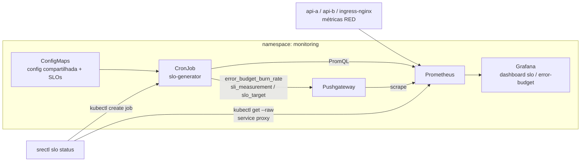

# SLO-as-code com o slo-generator

O srectl entrega SLOs em duas camadas:

1. **Recording rules do Prometheus** (`deploy/observability/slo-rules.yaml`) — séries
   de SLI rápidas e amigáveis para dashboards.
2. **`slo-generator`** (`deploy/slo/`) — recursos `ServiceLevelObjective`
   declarativos que calculam o **error budget**, o **burn rate** e a
   **política de error budget** de cada objetivo, e exportam o resultado de volta
   para o Prometheus.

A primeira camada responde *"como está a SLI agora?"*. A segunda responde
*"quanto do error budget gastamos, quão rápido, e precisamos acordar alguém?"*.
Juntas, ensinam o ciclo completo de SRE do Google sem sair do cluster kind local.

> Projeto upstream: [`fabianoflorentino/slo-generator`](https://github.com/fabianoflorentino/slo-generator)
> (fork de [`google/slo-generator`](https://github.com/google/slo-generator)).
> É uma ferramenta Python; o srectl a consome como imagem de container e mantém a
> CLI Go como um task runner fino.

## Conceitos em uma página

| Conceito | Fórmula | No srectl |
| --- | --- | --- |
| SLI | `eventos_bons / eventos_válidos` | PromQL sobre métricas da api-a, api-b e ingress |
| SLO | meta de uma SLI numa janela | `goal` no `ServiceLevelObjective` |
| Error budget (EB) | `1 - SLI` | calculado pelo `slo-generator` |
| Burn rate | `EB gasto / EB permitido` | métrica `error_budget_burn_rate` |
| Política de error budget | ações por limiar de burn rate | `error_budget_policies` na config compartilhada |

O burn rate é o sinal de alerta: 1x gasta o budget exatamente ao fim da janela;
14,4x gasta em ~2 dias. Alertar em burn rate multi-janela é mais estável do que
alertar num limiar cru de SLI.

## Arquitetura



### Componentes

| Peça | Manifesto | Função |
| --- | --- | --- |
| Config compartilhada | `deploy/slo/configmap-shared.yaml` | Backend Prometheus, exporter Pushgateway, políticas de error budget |
| SLOs | `deploy/slo/configmap-slos.yaml` | Um `ServiceLevelObjective` por arquivo/chave |
| CronJob | `deploy/slo/cronjob.yaml` | Executa `slo-generator compute --export` a cada minuto |
| Pushgateway | `deploy/slo/pushgateway.yaml` | Recebe as métricas calculadas |
| ServiceMonitor | `deploy/slo/pushgateway.yaml` | Faz o Prometheus raspar o Pushgateway |
| Dashboard | `deploy/slo/dashboard.yaml` | Burn rate, budget, SLI vs meta |
| App Argo CD | `deploy/bootstrap/apps/slo-app.yaml` | Aplica a pasta inteira via GitOps |
| Imagem | `apps/slo-generator/Dockerfile` | Runtime do `slo-generator` publicado pelo CI |

## Plano de implementação e integração

1. **Empacotar a ferramenta.** `apps/slo-generator/Dockerfile` constrói uma imagem
   pequena a partir do fork (`pip install /src[prometheus]`). O CI publica
   `ghcr.io/fabianoflorentino/srectl-slo-generator`.
2. **Declarar os SLOs.** Um `ServiceLevelObjective` por serviço/feature em
   `configmap-slos.yaml`:
   - disponibilidade da `api-a` (`good_bad_ratio`);
   - latência da `api-a` (`distribution_cut` em `le="0.02"`);
   - disponibilidade e latência do `fraudctl` (via ingress-nginx).
3. **Declarar a política.** `configmap-shared.yaml` define passos multi-janela
   (1h / 6h / 3d) com limiares de burn rate e mensagens de page/ticket.
4. **Agendar o cálculo.** O CronJob monta os dois ConfigMaps e roda
   `slo-generator compute -f /etc/slo/slos -c /etc/slo/config.yaml --export`.
5. **Exportar os resultados.** O exporter `prometheus` empurra para o Pushgateway
   interno; um ServiceMonitor faz o Prometheus raspá-lo.
6. **Operar pela CLI.** `srectl slo compute` dispara um Job avulso;
   `srectl slo status` lê as métricas exportadas pelo proxy de serviço da API do
   Kubernetes (sem port-forward).
7. **Ensinar.** A seção SRE do site e os runbooks transformam os números em
   exercícios (queima de budget, freeze de release, alertas multi-janela).

### Por que não só recording rules?

Recording rules pré-calculam a SLI, mas não modelam **error budget** nem
**políticas**. O `slo-generator` mantém objetivo, política e relatório num único
objeto YAML versionado — que é como times de SRE reais gerenciam SLOs. As
recording rules continuam úteis para dashboards rápidos e para PromQL de painéis
existentes.

## SLOs entregues

| Nome | Método do backend | SLI | Meta |
| --- | --- | --- | --- |
| `api-a-availability` | `good_bad_ratio` | requisições `/orders` não-5xx / todas | 99,5% |
| `api-a-latency` | `distribution_cut` | requisições ≤ 20ms / todas | 99,0% |
| `fraudctl-availability` | `good_bad_ratio` | requisições não-5xx no ingress / todas | 99,5% |

A política (`default`) tem três janelas:

| Passo | Janela | Limiar de burn rate | Ação |
| --- | --- | --- | --- |
| 1h | 3600s | 14,4x | page |
| 6h | 21600s | 6x | page |
| 3d | 259200s | 1x | ticket / freeze |

## CLI

```bash
srectl slo compute     # roda um Job avulso do slo-generator e espera concluir
srectl slo status      # tabela: serviço, SLO, burn rate, limiar, estado
```

Abra o Grafana e selecione **srectl · SLO / Error Budget** para ver os mesmos
dados graficamente:

```bash
srectl open grafana
```

## Lab: queime o error budget

Pré-requisitos: `srectl up`, `srectl demo verify` e o dashboard de SLO verde.

1. **Baseline.** Rode `srectl slo compute` e `srectl slo status`; todas as linhas
   devem estar abaixo do limiar.
2. **Carga.** Gere tráfego saudável:
   ```bash
   srectl demo load --duration 120s --rps 30
   ```
3. **Quebre.** Injete stress de CPU na api-a para a latência subir:
   ```bash
   srectl demo chaos latency --duration 120s
   ```
4. **Observe.** Enquanto o drill roda:
   ```bash
   srectl slo status
   ```
   O burn rate da latência da api-a passa do limiar de 1h; o painel do Grafana
   fica vermelho.
5. **Decida.** Leia as mensagens da política: page (1h/6h) vs. freeze de release
   (3d). Escreva o que você faria como plantonista.
6. **Recupere.** Deixe o experimento de caos expirar e confirme que o burn rate
   volta para baixo do limiar.

### Perguntas para discussão

- Por que uma meta de 99,5% em 30 dias é diferente de "nenhum 5xx na última hora"?
- Qual SLI é mais honesta para o `fraudctl`: a resposta do ingress ou da
  aplicação? O que cada uma esconde?
- Quando alertar em `error_budget_burn_rate` é melhor do que alertar na SLI crua?
  Quando é pior?
- Qual é o custo de um page falso comparado ao custo de um SLO perdido?

## Operação

| Sintoma | Verificação |
| --- | --- |
| `slo status` diz "no metrics yet" | `kubectl get jobs -n monitoring -l job-name=slo-generator`; rode `srectl slo compute` |
| CronJob falha | `kubectl logs -n monitoring -l job-name=slo-generator --tail=100` |
| Prometheus sem `error_budget_burn_rate` | Pushgateway de pé; target do ServiceMonitor `UP`; o CronJob rodou ao menos uma vez |
| Burn rate sempre zero | os seletores PromQL não casam com nenhuma série — confira labels de route/ingress em `configmap-slos.yaml` |
| Erro de pull da imagem | publique a imagem (veja `apps/slo-generator/Dockerfile`) e fixe a tag em `cronjob.yaml` |

Comandos úteis:

```bash
kubectl -n monitoring get cronjob,job,pod -l app=slo-generator
kubectl -n monitoring create job --from=cronjob/slo-generator slo-manual
kubectl -n monitoring logs job/slo-manual
kubectl -n monitoring get --raw \
  '/api/v1/namespaces/monitoring/services/http:kube-prometheus-stack-prometheus:9090/proxy/api/v1/query?query=error_budget_burn_rate'
```

## Referências

- [Google SRE Book — Service Level Objectives](https://sre.google/sre-book/service-level-objectives/)
- [Google SRE Workbook — Alerting on SLOs](https://sre.google/workbook/alerting-on-slos/)
- [`fabianoflorentino/slo-generator`](https://github.com/fabianoflorentino/slo-generator)
- [`docs/pt-br/OBSERVABILITY.md`](OBSERVABILITY.md) — a stack LGTM por trás das métricas
