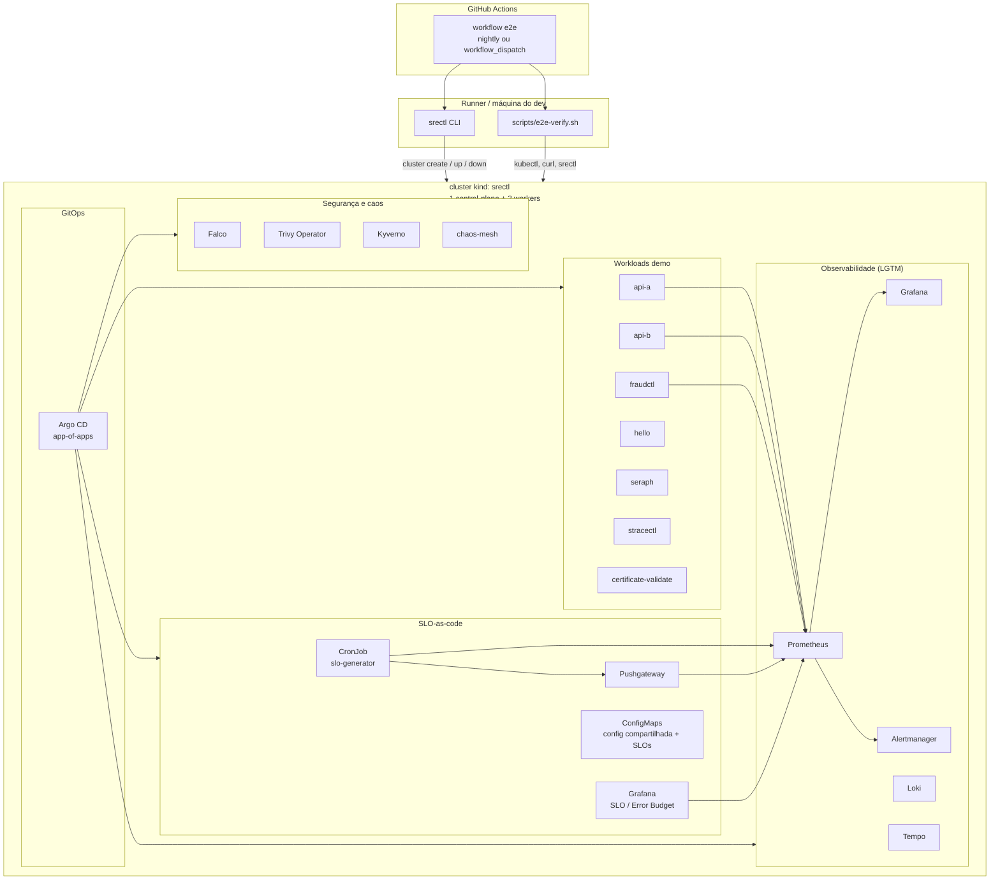
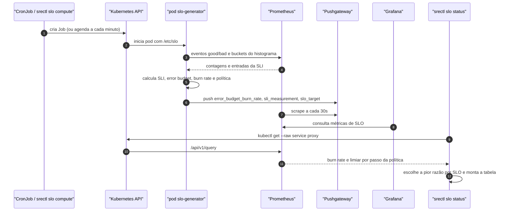
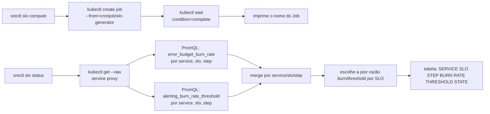
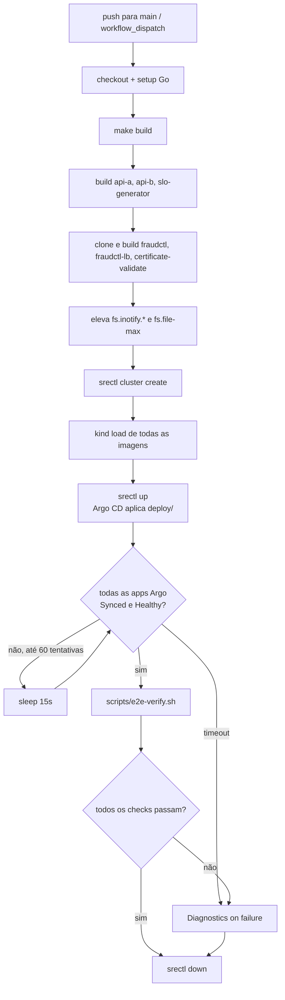
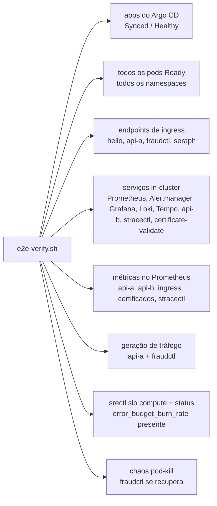
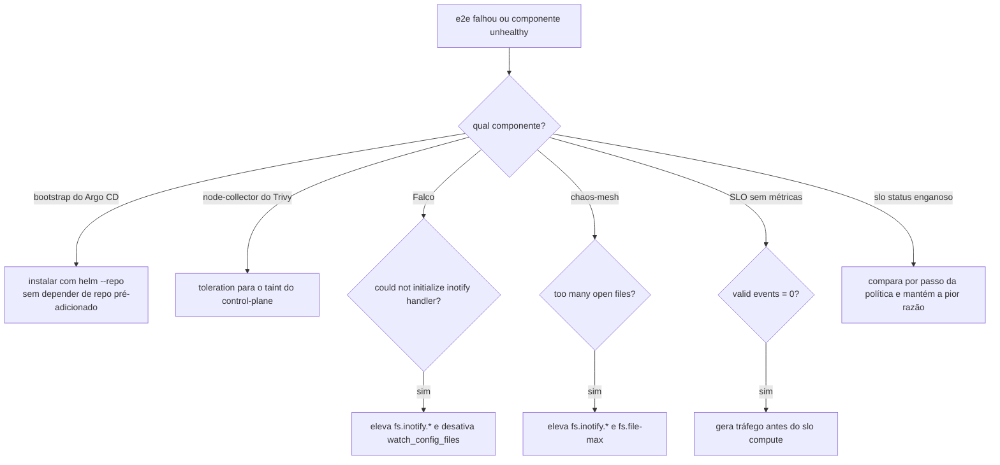

# SLO-as-code + pipeline end-to-end — notas de implementação

Este documento registra a implementação de duas features entregues juntas:

1. **SLO-as-code** com o [`slo-generator`](https://github.com/fabianoflorentino/slo-generator):
   recursos `ServiceLevelObjective` declarativos, error budgets, burn rates e uma
   política de error budget multi-janela.
2. **Um pipeline end-to-end completo no GitHub Actions** que builda todas as imagens,
   sobe a plataforma inteira no kind e verifica o cluster, todos os serviços, as
   métricas, os SLOs e um drill de caos.

Complementa:

- [`SLO.md`](SLO.md) — conceitos de SLO, design e o lab prático.
- [`CI_CD.md`](CI_CD.md) — visão do pipeline e estratégia de imagens.
- [`OBSERVABILITY.md`](OBSERVABILITY.md) — a stack LGTM por trás das métricas.

## 1. O que foi entregue

| Área | Entrega |
| --- | --- |
| Modelo de SLO | 3 `ServiceLevelObjective` (`api-a` disponibilidade/latência, `fraudctl` disponibilidade) |
| Política de error budget | 1h @ 14,4x (page), 6h @ 6x (page), 3d @ 1x (freeze de release) |
| Runtime | CronJob do `slo-generator` a cada minuto + Job sob demanda |
| Exportação | Pushgateway + ServiceMonitor + métricas no Prometheus |
| Dashboards | Grafana **srectl · SLO / Error Budget** |
| CLI | `srectl slo compute` e `srectl slo status` |
| Imagem | `apps/slo-generator/Dockerfile` → `ghcr.io/.../srectl-slo-generator:v0.1.0` |
| GitOps | `deploy/slo/` aplicado pela Application `slo` do Argo CD |
| Pipeline E2E | `.github/workflows/e2e.yml` + `scripts/e2e-verify.sh` |
| Verificação | e2e nightly/manual verde no GitHub Actions; run local completo verde |
| Docs/site | guias EN + PT-BR, entrada de runbook, páginas Hugo |

## 2. Arquitetura end-to-end



## 3. Loop de controle do SLO



### 3.1 Recursos de SLO

| Nome | Método | SLI | Meta |
| --- | --- | --- | --- |
| `api-a-availability` | `good_bad_ratio` | requisições `GET /orders` não-5xx / todas | 99,5% |
| `api-a-latency` | `distribution_cut` | requisições `GET /orders` ≤ 20ms / todas | 99,0% |
| `fraudctl-availability` | `good_bad_ratio` | requisições não-5xx no ingress / todas com `ingress=fraudctl` | 99,5% |

> `api-a-latency` usa o bucket `le="0.02"` do histograma. As apps demo adicionam
> `0.02` aos buckets padrão do Prometheus para o SLO ter um bucket exato.

### 3.2 Política de error budget

| Passo | Janela | Limiar de burn rate | Consequência |
| --- | --- | --- | --- |
| 1 hora | 3600s | 14,4x | page no plantonista |
| 6 horas | 21600s | 6x | page no plantonista |
| 3 dias | 259200s | 1x | congela releases exceto confiabilidade/segurança |

### 3.3 Métricas exportadas

| Métrica | Função |
| --- | --- |
| `error_budget_burn_rate` | burn rate por serviço/SLO/passo |
| `alerting_burn_rate_threshold` | limiar de cada passo da política |
| `sli_measurement` | SLI medida ao longo do tempo |
| `slo_target` | linha da meta nos dashboards |
| `events_count` | contagem de eventos bons/ruins |

Labels: `service_name`, `feature_name`, `slo_name`,
`error_budget_policy_step_name`, mais labels de metadata achatadas.

## 4. Fluxo dos comandos `srectl slo`



| Comando | Comportamento |
| --- | --- |
| `srectl slo compute` | cria um Job avulso a partir do CronJob, espera até 120s e imprime o nome |
| `srectl slo status` | lê as métricas pelo proxy de serviço do Kubernetes (sem port-forward), escolhe o pior passo por SLO e imprime a tabela |

A tabela compara **burn rate vs limiar por passo da política** e mantém o pior
passo, então um burn lento de 3 dias (limiar 1x) nunca fica escondido pelo limiar
de 1 hora (14,4x).

## 5. Pipeline end-to-end



O workflow aponta o Argo CD para o **commit exato em teste**:

```yaml
env:
  SRECTL_ARGOCD_REPO: ${{ github.server_url }}/${{ github.repository }}
  SRECTL_ARGOCD_REVISION: ${{ github.sha }}
```

### 5.1 Imagens buildadas pelo pipeline

| Imagem | Origem |
| --- | --- |
| `srectl/api-a:dev` | `apps/api-a/Dockerfile` |
| `srectl/api-b:dev` | `apps/api-b/Dockerfile` |
| `ghcr.io/fabianoflorentino/srectl-slo-generator:v0.1.0` | `apps/slo-generator/Dockerfile` (tag lida de `deploy/slo/cronjob.yaml`) |
| `srectl/fraudctl:dev`, `srectl/fraudctl-lb:dev` | `github.com/fabianoflorentino/fraudctl` |
| `srectl/certificate-validate:dev` | `github.com/fabianoflorentino/certificate-validate` |

`stracectl` e `seraph` usam imagens publicadas e são apenas baixadas.

### 5.2 O que `scripts/e2e-verify.sh` verifica



1. `srectl demo verify` — cluster, Argo CD e todas as Applications.
2. Todos os pods de todos os namespaces `Ready` (pods de batch do `slo-generator` excluídos).
3. Endpoints de ingress: `hello`, `api-a` (`/health`, `/ready`, `/orders`), `fraudctl`
   (`/ready` e um `POST /fraud-score` real) e `seraph`.
4. Serviços in-cluster via proxy de serviço.
5. Métricas presentes no Prometheus.
6. Gera tráfego, roda `srectl slo compute` e `srectl slo status` lista os SLOs.
7. Um `pod-kill` de caos no `fraudctl` se recupera.

Em falha, o workflow despeja nodes, Applications, pods, workloads, eventos,
`kubectl top`, memória do host, limites de inotify e logs de Falco/chaos, e sempre
roda `srectl down`.

## 6. Problemas encontrados e corrigidos na implementação



| Sintoma | Causa raiz | Correção |
| --- | --- | --- |
| `Error: repo argo not found` | `helm upgrade` assumia o repo `argo` já adicionado | `helm upgrade --install argo-cd argo-cd --repo https://argoproj.github.io/argo-helm` |
| `node-collector` do Trivy preso em `Pending` | mira o control-plane por hostname, mas não tolerava o taint | `nodeCollector.tolerations` para `node-role.kubernetes.io/control-plane:NoSchedule` |
| Falco `could not initialize inotify handler` | a stack completa esgota as instâncias de inotify do runner | `sysctl fs.inotify.*` no workflow + `falco.watch_config_files: false` |
| chaos-mesh `too many open files` | informers do controller-runtime esgotam inotify/file limits | eleva `fs.inotify.*` e `fs.file-max` antes de criar o cluster |
| `slo-generator` quebra ao iniciar (`pkg_resources`) | setuptools 81+ removeu `pkg_resources`, usado pelo slo-generator | pina `setuptools<81` na imagem |
| SLOs com `Not enough valid events (0.0)` | sem tráfego na janela do SLO | gera carga antes do `slo compute` |
| `slo status` podia esconder um burn lento | comparava o maior burn rate com o maior limiar | merge por passo da política e mantém a pior razão |

## 7. Evidências de verificação

| Check | Resultado |
| --- | --- |
| e2e no GitHub Actions (run `44619937023`) | **success** em 11m17s |
| `ci` no GitHub Actions no mesmo push | **success** |
| e2e local completo (`scripts/e2e-verify.sh`) | todos os checks verdes, incluindo SLO e caos |
| `go test -race ./...` | passa |
| `make coverage` | 82,0% geral; `internal/slo` 96,4%; `internal/cli` 84,3% |
| `golangci-lint run ./...` | 0 issues |
| build do site Hugo | páginas EN/PT-BR geradas |

O run e2e prova a cadeia inteira: imagens buildadas do código → cluster criado →
Argo CD aplicou o commit exato → todos os serviços acessíveis → métricas presentes →
`error_budget_burn_rate` exportado → drill de caos recuperado.

## 8. Mapa de arquivos

| Caminho | Responsabilidade |
| --- | --- |
| `deploy/slo/configmap-shared.yaml` | backend Prometheus, exporter Pushgateway, política |
| `deploy/slo/configmap-slos.yaml` | os três `ServiceLevelObjective` |
| `deploy/slo/cronjob.yaml` | `slo-generator compute --export` agendado |
| `deploy/slo/pushgateway.yaml` | Deployment/Service/ServiceMonitor do Pushgateway |
| `deploy/slo/dashboard.yaml` | dashboard **srectl · SLO / Error Budget** |
| `deploy/bootstrap/apps/slo-app.yaml` | Application do Argo CD para `deploy/slo` |
| `apps/slo-generator/Dockerfile` | imagem pinada do slo-generator (`setuptools<81`) |
| `internal/slo/slo.go` | disparo do Job + consultas no Prometheus + tabela |
| `internal/cli/slo.go` | `srectl slo compute` e `srectl slo status` |
| `internal/config/config.go` | configuração `slo.*` e defaults |
| `config/srectl.yaml` | namespace, CronJob, serviço/porta do Prometheus |
| `.github/workflows/e2e.yml` | pipeline e2e completo |
| `scripts/e2e-verify.sh` | asserções de serviços/SLO/caos usadas local e na CI |
| `Makefile` | alvos `docker-build-slo` (tag pinada) e `e2e` |
| `.github/workflows/images.yml` | publica `srectl-slo-generator` |
| `deploy/bootstrap/apps/falco-app.yaml` | `watch_config_files: false` |
| `deploy/bootstrap/apps/trivy-operator-app.yaml` | toleration do node-collector |
| `internal/appobs/metrics.go` | adiciona o bucket `0.02` usado pelo SLO de latência |

## 9. Operação

```bash
# Sobe a plataforma (local)
srectl up
srectl demo verify

# Imagem usada pelo CronJob (tag exata do manifesto)
make docker-build-slo
kind load docker-image "$(awk '/srectl-slo-generator/ {print $2; exit}' deploy/slo/cronjob.yaml)" --name srectl

# SLOs
srectl slo compute
srectl slo status
srectl open grafana   # dashboard: srectl · SLO / Error Budget

# e2e completo contra um cluster em execução
make e2e

# e2e completo no GitHub Actions
gh workflow run e2e.yml
gh workflow run e2e.yml -f skip_chaos=true
```

## 10. Troubleshooting

| Sintoma | Verificação |
| --- | --- |
| `slo status` mostra "no exported metrics" | rode `srectl slo compute`; confirme o Job concluído e o scrape do Pushgateway |
| SLOs logam `Not enough valid events` | gere tráfego (`srectl demo load`) antes de computar |
| CronJob não consegue baixar a imagem | build/carregue a tag pinada em `deploy/slo/cronjob.yaml` ou publique via workflow `images` |
| Falco em crash loop num runner de CI | confira `fs.inotify.max_user_instances`; o workflow eleva |
| chaos controller `too many open files` | mesmos limites de inotify/file-max |
| node-collector do Trivy `Pending` | confirme a toleration do control-plane |
| e2e travado esperando apps | rode `srectl status`; o passo de diagnostics lista as Applications com problema |

## 11. Limitações conhecidas e próximos passos

- O e2e é **nightly/manual** porque é pesado (stack LGTM + segurança + caos
  completa). Não roda em todo pull request.
- Runners hospedados no GitHub precisam de ajuste explícito de inotify/file limits;
  o workflow faz isso, mas uma imagem de runner diferente pode precisar de outros valores.
- A imagem do `slo-generator` está pinada em `v0.1.0`; o e2e builda e carrega essa
  tag exata. Para um release, crie a tag do repositório para o `images.yml` publicá-la.
- `srectl slo status` mostra o pior passo por SLO; o dashboard do Grafana mostra
  todos os passos. Use o dashboard quando precisar da visão multi-janela completa.
